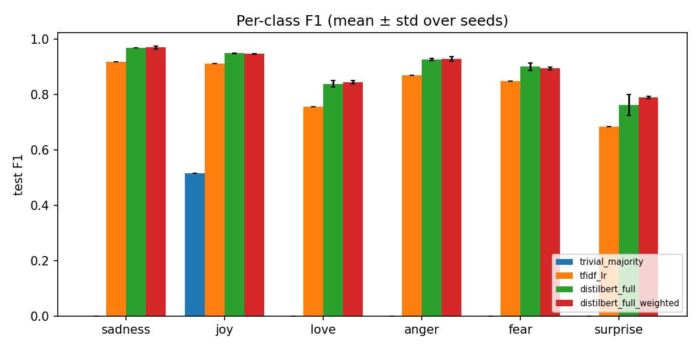
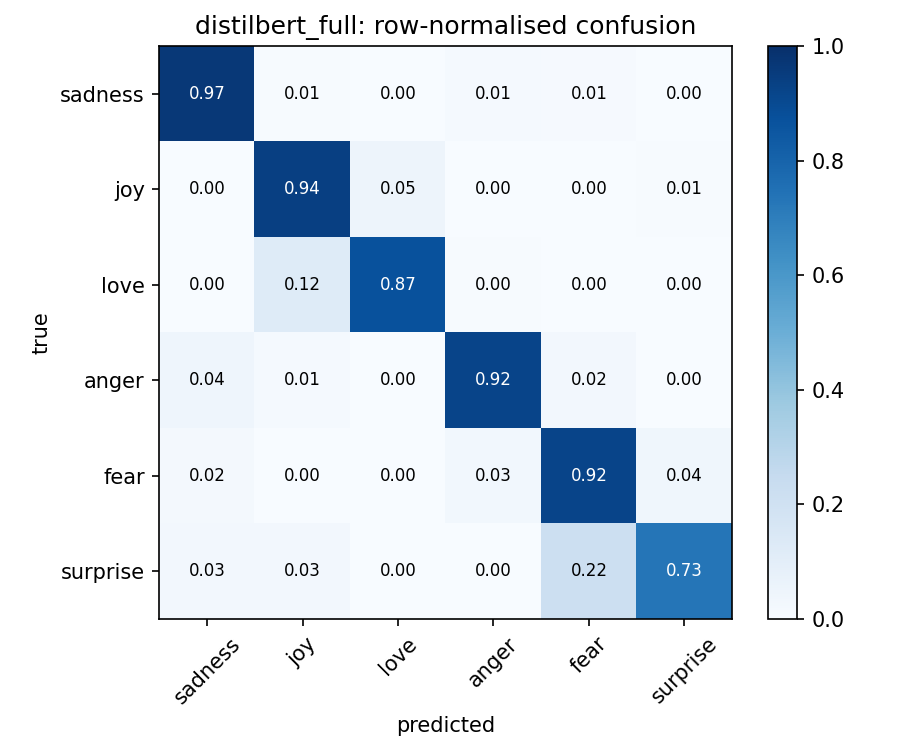
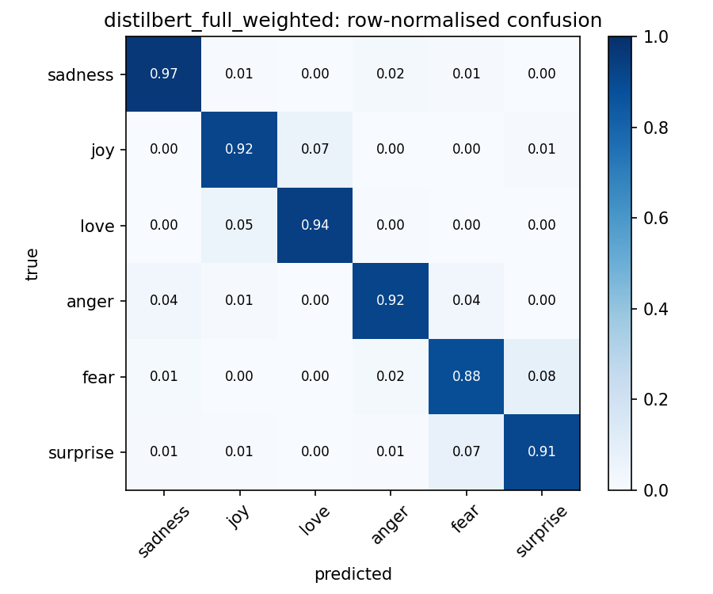

# 1. Framing

**Task.** Classify an English tweet into one of six emotions (sadness, joy, love, anger, fear, surprise) using the `dair-ai/emotion` dataset (16,000 / 2,000 / 2,000 official split). TODO: one or two sentences on why this matters.

**Metric.** Macro-F1 is our primary metric: it averages the F1 of the six classes with equal weight. The classes are imbalanced (surprise ≈3.6 % of training data, love ≈8.2 %, joy ≈33.5 %), so accuracy is misleading: predicting "joy" for every tweet already gives 0.347 accuracy but only 0.086 macro-F1. We also report per-class precision, recall and F1, because the question of interest is how the rare classes are treated.

**Comparison.** Four models on the same split and metric: a majority-class baseline, TF-IDF + logistic regression, fine-tuned `distilbert-base-uncased` (main model), and the same model with one change, a class-weighted loss (improvement).

# 2. Data and exploratory analysis

The official split is kept. Hyper-parameters and the best epoch are chosen on the validation set only; the test set is predicted once per run, after selection. The TF-IDF vectoriser is fitted on training text only (inside a scikit-learn pipeline).

*Class balance.* Joy and sadness dominate; love and surprise are rare (test support: sadness 581, joy 695, love 159, anger 275, fear 224, surprise 66). TODO: insert `class_balance.png` from the EDA notebook.

*Length.* TODO: mean / 95th / 99th percentile / max token length from the EDA notebook. Only 0.16 % of training tweets exceed 64 tokens, so truncating at 64 is safe.

*Leakage check.* 31 texts are duplicated inside the training set; 11 test texts also occur in the training set (5 train∩validation, 3 validation∩test), and 30 training texts carry more than one label. All 11 train∩test texts have a *different* label in test than in train, and the main model (seed 0) classified 1 of 11 correctly. The overlap therefore does not inflate our results; it contributes about 10 unavoidable errors (≈0.5 accuracy points, about 7 % of that model's errors). We kept the official split and report this as a limitation.

*Label noise.* The labels come from distant supervision (hashtags). Sampled training tweets include arguably mislabelled examples, e.g. "i feel satisfied and sad at the same time" (joy) and "i plan to run miles in the morning ... leaves my bunion feeling extremely tender and painful" (love). This limits the achievable score and is consistent with the confusions found below.

# 3. Methods

| Model | Description |
|---|---|
| Trivial baseline | predict the most frequent class (joy) |
| Baseline | TF-IDF (word n-grams, `min_df = 2`, sublinear tf) + logistic regression; C ∈ {0.3, 1, 3, 10, 30, 100} and n-gram range ∈ {(1,1), (1,2)} chosen on validation macro-F1 |
| Main model | `distilbert-base-uncased` (66.96 M parameters, all trainable), Hugging Face `Trainer`; lr 5e-5, 4 epochs, batch size 32, max length 64, weight decay 0.01, 6 % linear warm-up, fp16; checkpoint with best validation macro-F1 |
| + improvement | identical, but the cross-entropy loss uses class weights $w_c = N / (K\, n_c)$ computed from training-label counts (sadness 0.57, joy 0.50, love 2.05, anger 1.24, fear 1.38, surprise 4.66) |

*Why this improvement.* The classes are imbalanced and the brief highlights that "surprise" is rare. Up-weighting the loss of rare classes is the simplest change that directly targets them; we hypothesised it would raise rare-class F1. Only the loss is changed, so any difference is attributable to it. Each transformer configuration was run with seeds 0, 1, 2.

# 4. Results

| Model | Macro-F1 | Accuracy | Train time (s) | Trainable params |
|---|---|---|---|---|
| Trivial baseline | 0.086 | 0.347 | – | 0 |
| TF-IDF + LR | 0.831 | 0.881 | 101 † | 43,554 |
| DistilBERT | 0.891 ± 0.007 | 0.931 ± 0.002 | 137 ± 7 | 66,958,086 |
| + class-weighted loss | 0.895 ± 0.001 | 0.930 ± 0.002 | 157 ± 38 ‡ | 66,958,086 |

Test set; mean ± std over 3 seeds for the transformers, single deterministic run for the baselines. † includes the hyper-parameter grid search on CPU. ‡ Time differences between runs reflect Colab checkpoint-writing speed, not the method. Peak GPU memory ≈1.37 GB on a T4.

{ width=85% }

**Main model vs baseline.** DistilBERT improves macro-F1 by about 0.06 over TF-IDF (95 % bootstrap CIs, seed 0: TF-IDF [0.805, 0.852]; DistilBERT [0.872, 0.913]; they do not overlap). The largest per-class gains are on the rare classes: surprise 0.683 → 0.761 and love 0.755 → 0.838.

**Learning curves.** Validation loss was lowest around epoch 2–3 and rose slightly by epoch 4 while validation macro-F1 stayed flat (≈0.91–0.92), a mild sign of over-fitting; best-epoch selection on validation macro-F1 guards against it.

# 5. Does the improvement help?

Not in macro-F1. The difference between the weighted and unweighted model (0.895 vs 0.891) is smaller than the main model's seed-to-seed standard deviation (0.007), the bootstrap CIs overlap almost entirely, and a McNemar test on seed 0 (weighted fixed 48 tweets, broke 55) gives p = 0.55.

The class weights nevertheless change the model's behaviour. Seed-0 precision and recall:

| Class (support) | Precision: main → weighted | Recall: main → weighted |
|---|---|---|
| surprise (66) | 0.845 → 0.677 | 0.742 → 0.955 |
| love (159) | 0.807 → 0.766 | 0.843 → 0.950 |
| fear (224) | 0.884 → 0.907 | 0.915 → 0.871 |
| joy (695) | 0.952 → 0.980 | 0.945 → 0.917 |
| macro average | 0.898 → 0.872 | 0.891 → 0.927 |

The weighted model finds almost all surprise tweets (63 of 66 instead of 49) but predicts "surprise" far more often, so its false alarms rise. Macro recall increases by 0.036 and macro precision falls by 0.026; F1, which balances the two, is unchanged (0.894 for both on seed 0). The frequent classes pay the cost: joy and fear lose recall. Surprise F1 is also more stable across seeds with weights (std 0.004 vs 0.038), but this rests on three seeds and 66 test tweets, so we regard it as suggestive and not established.

**Conclusion.** The class-weighted loss moves the operating point toward recall on rare emotions without improving overall quality. It is the better choice only if missing a rare emotion is more costly than a false alarm; otherwise the two models are equivalent. An improvement that does not raise the headline metric is still an informative result, because the mechanism is visible in the precision/recall table.

# 6. Error analysis

{ width=48% } { width=48% }

The dominant confusions are the two pairs highlighted in the brief. Without weights, love is predicted as joy for 12 % of love tweets and surprise as fear for 22 % of surprise tweets; with weights these fall to 5 % and 7 %, while the reverse errors grow (fear → surprise 4 % → 8 %, joy → love 5 % → 7 %). TF-IDF is much worse on the same pairs (love → joy 22 %, surprise → joy 14 %, surprise → fear 17 %). These emotions overlap semantically and the labels are noisy, so some of these errors reflect the data and not the model.

**Manual analysis of 20 misclassified tweets.** TODO: from `results/error_analysis_distilbert_full_weighted.csv`, give counts per category (label noise, genuine ambiguity, negation, sarcasm, very short text, other) and 2–3 example tweets with your explanation. Also state how many of the 20 are among the 11 duplicated train/test texts.

# 7. Limitations, ethics and next steps

*Limitations.* Noisy distant-supervision labels cap performance; surprise has only 66 test tweets; only three seeds were run; one improvement was tested; the data are English-language tweets from one period.

*Ethics.* Emotion inference can be misused for profiling or surveillance. This is an educational model and must not be used to make decisions about individuals. The pre-trained model inherits biases from its training corpus.

*What we would try next.* Softer class weights (e.g. the square root of inverse frequency), decision thresholds tuned on validation to hit a chosen precision/recall balance, parameter-efficient fine-tuning (LoRA) to compare cost against accuracy, and a larger model such as RoBERTa. We did not test these, so we make no claim about them.

# 8. AI-use statement

TODO – be specific about which tools were used, for what, and what you verified yourselves (see the README for an example).

# References

1. E. Saravia, H.-C. T. Liu, Y.-H. Huang, J. Wu, Y.-S. Chen. *CARER: Contextualized Affect Representations for Emotion Recognition.* EMNLP 2018.
2. V. Sanh, L. Debut, J. Chaumond, T. Wolf. *DistilBERT, a distilled version of BERT: smaller, faster, cheaper and lighter.* 2019.
3. T. Wolf et al. *Transformers: State-of-the-Art Natural Language Processing.* EMNLP 2020 (System Demonstrations).
